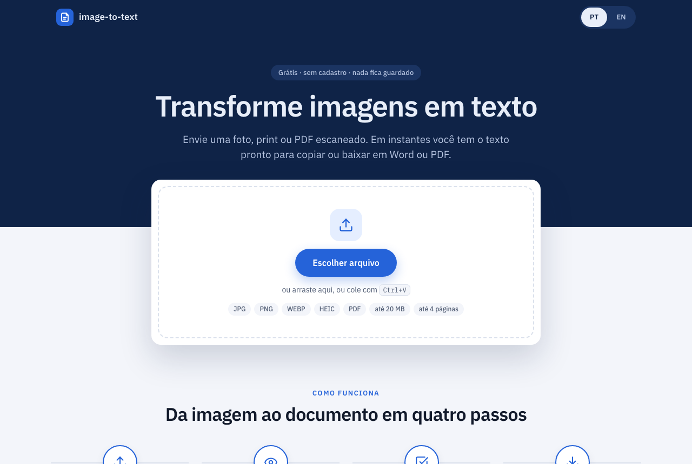
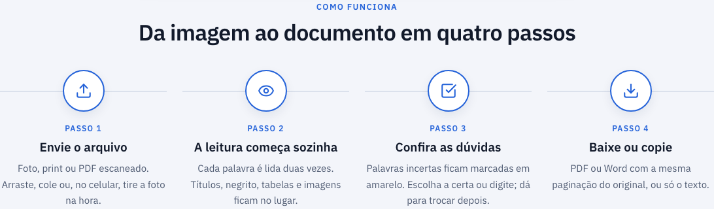
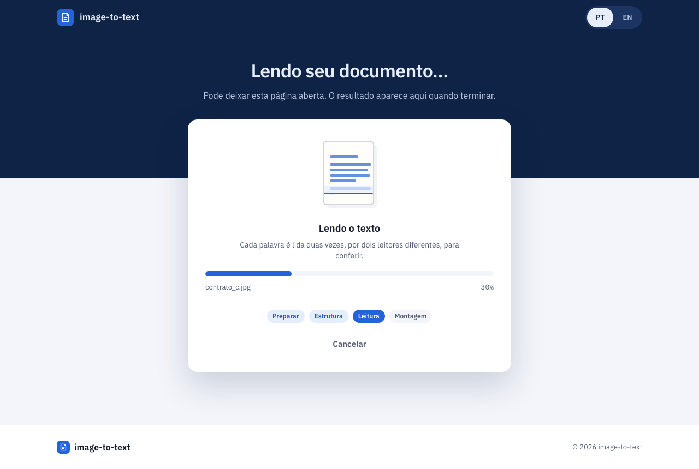
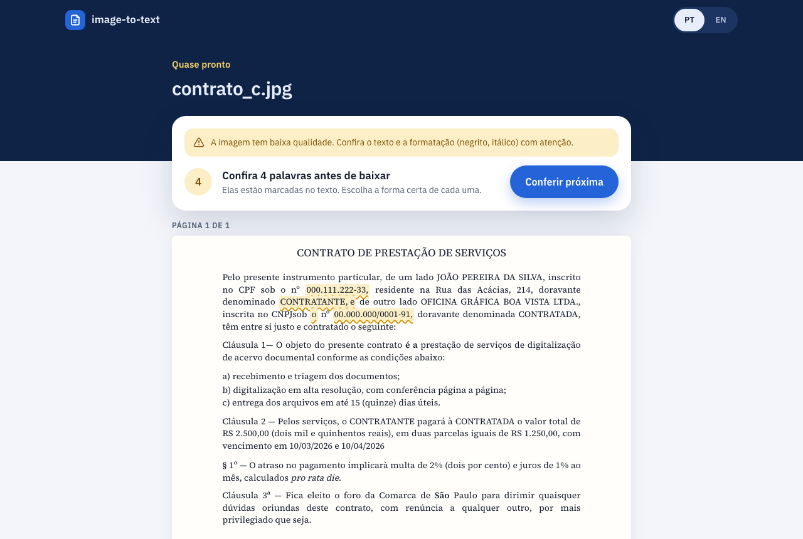
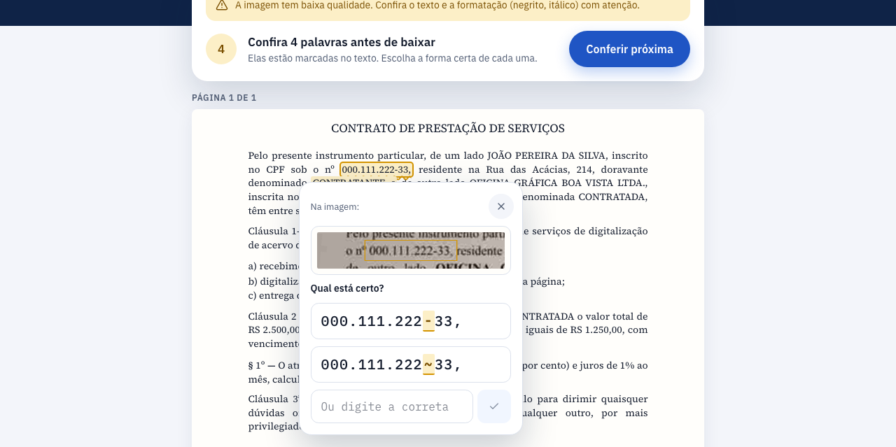
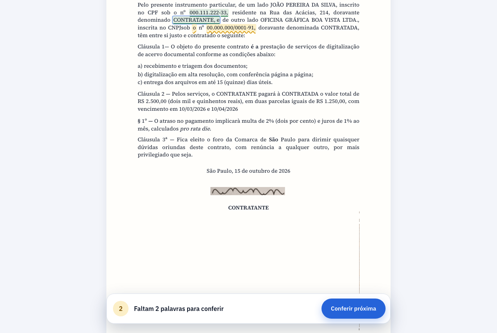
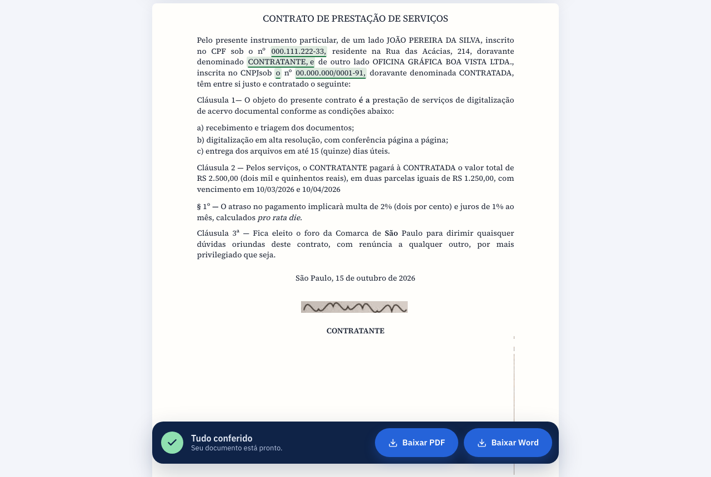
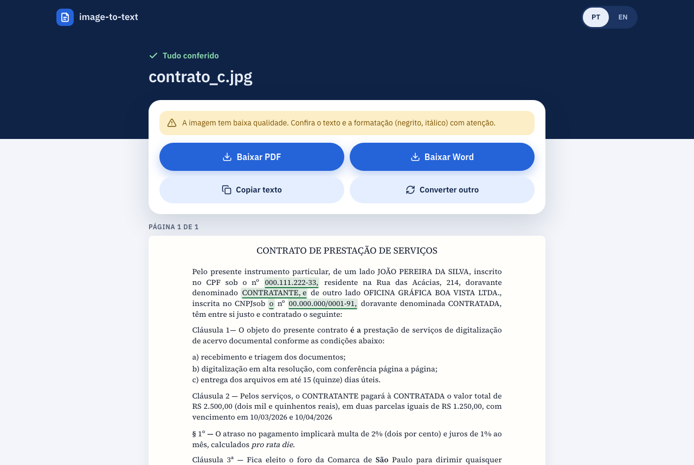

# image-to-text

Converte **uma imagem ou um PDF escaneado** em texto e em um **documento novo (Word ou PDF)**, com máxima fidelidade ao original: mesma paginação, organização, formatação e imagens.

O site é gratuito, sem conta e sem opções. A pessoa escolhe o arquivo, a leitura começa sozinha, ela confere as palavras em dúvida e baixa o resultado. Nada fica guardado.

> **Status:** projeto completo e testado localmente, **não publicado**. Veja [Publicação](#publicação).

## Como funciona

### 1. Envie o arquivo
Foto, print ou PDF escaneado (JPG, PNG, WEBP, HEIC ou PDF, até 20 MB e 20 páginas). Dá para escolher, arrastar, colar com Ctrl+V ou tirar uma foto no celular.



A própria página ensina o caminho em quatro passos:



### 2. A leitura começa sozinha
A tela mostra a etapa real (preparando a imagem, encontrando títulos e parágrafos, lendo o texto, montando o documento), a página atual e o percentual.



### 3. Confira as dúvidas
O resultado aparece como o documento final, página por página. Palavras em que os leitores não concordaram ficam marcadas em amarelo, e baixar só é liberado depois de conferir todas.



Ao clicar numa dúvida, um quadro abre junto da palavra. Ele mostra o recorte da imagem original e as leituras possíveis, com a diferença destacada, e deixa digitar a forma certa.



Uma barra fixa no pé da tela mostra quantas faltam e leva à próxima:



Ao terminar, a barra avisa que está tudo conferido e já oferece os downloads:



### 4. Baixe ou copie
Copiar o texto, baixar Word ou baixar PDF. São documentos novos, com texto editável, na mesma ordem e formatação do original, e as imagens não-texto (logotipos, fotos, assinaturas) ficam na mesma posição.



## Como a precisão é garantida

- **Duas leituras independentes**: PaddleOCR e docTR leem cada trecho. O que concordam é aceito; nas divergências decidem a confiança, uma releitura ampliada e medidas na própria imagem (hífen × travessões, "°" × "o").
- **Conferência humana**: o que continua incerto vira dúvida, com as alternativas.
- **Nada inventado**: transcrição literal, e o que não dá para ler vira "[ilegível]".
- **Nada faltando**: regiões com conteúdo que nenhum bloco cobriu são lidas de novo.
- **Metas medidas** num conjunto de teste sintético: erro de caracteres ≤ 1% e de palavras ≤ 2% em texto impresso.

## Stack

| Parte | Ferramentas |
|---|---|
| Site | Next.js 16, React 19, TypeScript, Tailwind 4, Vitest e Playwright |
| API e fila | FastAPI, Pydantic, Celery e Redis |
| Imagem | OpenCV e pypdfium2 |
| Leitura | PaddleOCR (layout + texto) e docTR (segunda leitura) |
| Documentos | python-docx e LibreOffice (PDF) |

Tudo é gratuito: sem API paga e sem IA externa. As imagens não saem do servidor.

## Rodar localmente

**Requisitos:** Docker e Node.js 20 ou mais.

```sh
# Backend: API (porta 8000), worker e Redis.
# No primeiro build ele baixa os modelos de leitura, alguns minutos.
docker compose up -d --build

# Site (porta 3000)
cd frontend
cp .env.example .env.local
npm install
npm run dev
```

Abra http://localhost:3000.

O PaddlePaddle só existe para Linux x86. Em Macs com chip Apple, o Docker emula esse processador e cada página leva alguns minutos. Num servidor x86 leva de 20 a 40 segundos.

### Testes

```sh
cd backend && uv run pytest && uv run ruff check . && uv run mypy app
cd backend && uv run pytest -m precision -s   # precisão contra os gabaritos (lento)
cd frontend && npm test && npm run lint && npx tsc --noEmit
cd frontend && npm run test:e2e               # ponta a ponta, com o backend rodando
```

## Organização

```
backend/    API, fila e pipeline de conversão (preprocess, layout, leitura, reconciliação, exportação)
frontend/   site: envio → convertendo → resultado
openspec/   especificações (fonte da verdade do comportamento) e decisões de design
docs/       telas e rotas, publicação e imagens deste README
```

O projeto segue **desenvolvimento guiado por especificação**: toda mudança começa ajustando a spec em `openspec/`, depois vêm os testes e só então o código.

## Publicação

O backend precisa de cerca de **3 GB de memória**, porque carrega os dois leitores. Por isso não cabe nos planos gratuitos comuns (Render e Railway têm 512 MB, e o Hugging Face Spaces passou a cobrar pelos Spaces com Docker em 2026). O site em si roda grátis na Vercel.

Em [docs/deploy.md](docs/deploy.md) estão o passo a passo e as opções avaliadas. Um caminho gratuito possível é o Modal, com créditos mensais e um contêiner que "dorme" sem uso.

## Licença

© 2026 Alan Santos. **Todos os direitos reservados.** O código está visível para consulta, mas não pode ser copiado, modificado, distribuído nem usado sem autorização por escrito. Veja [LICENSE](LICENSE).
